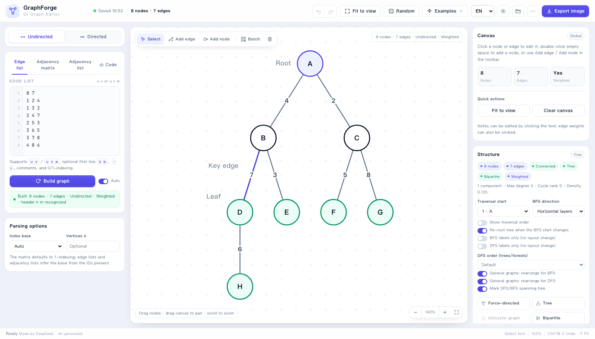
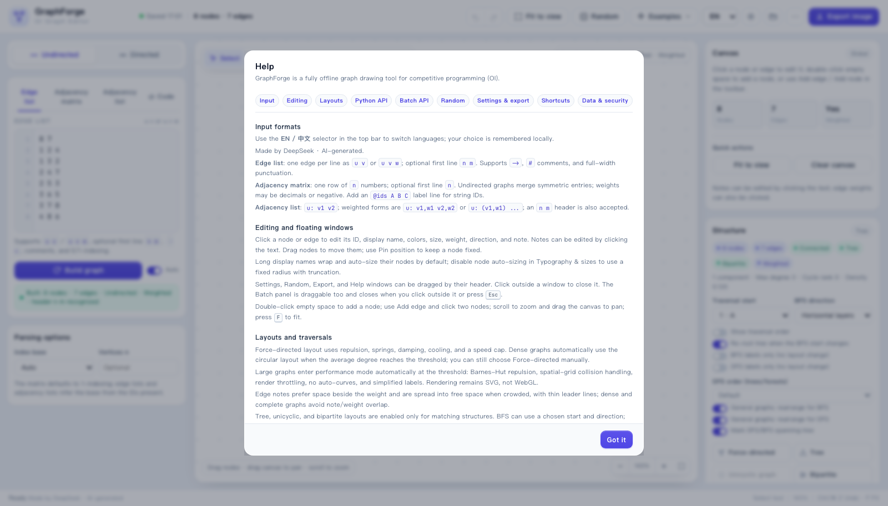
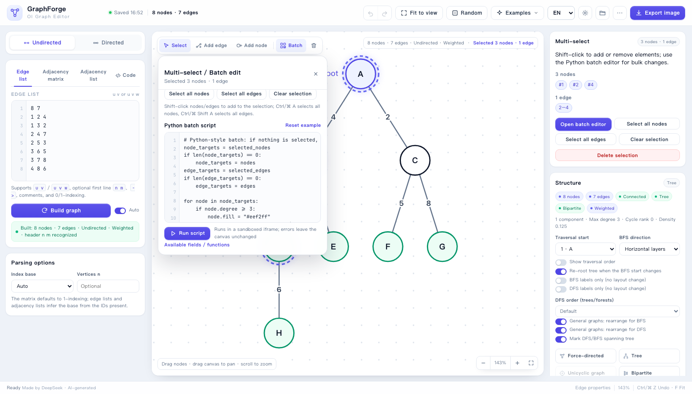
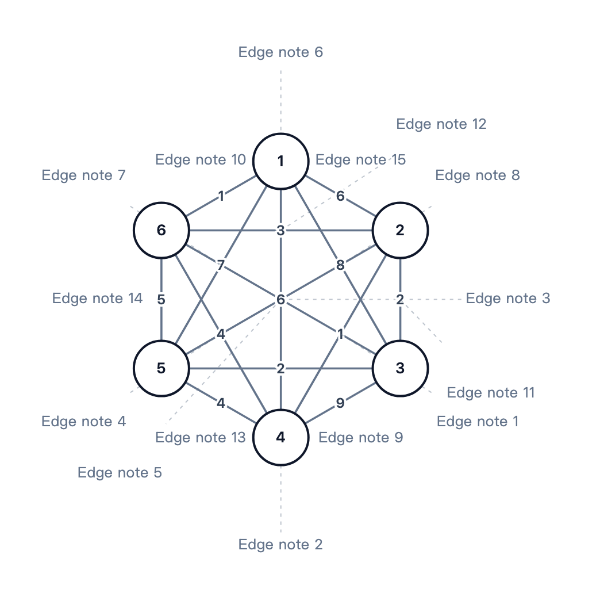
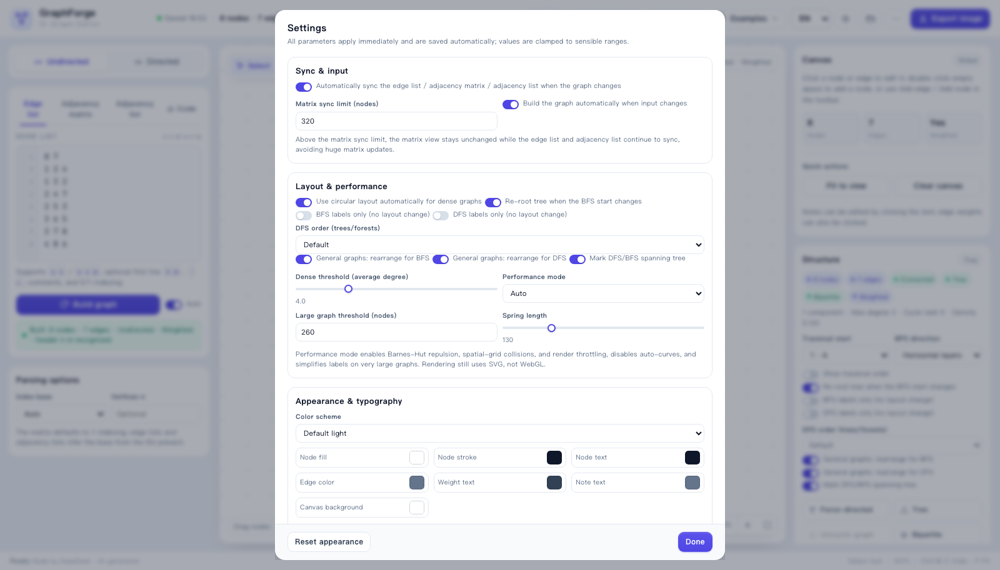
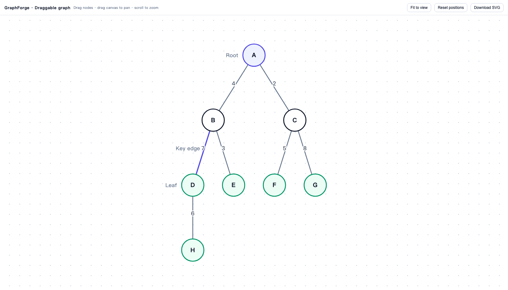

# MysteryPSD.github.io
At present, I put GraphForge, an AI-generated graph editor for algorithm competitions here. Here's the main README file.
# GraphForge · OI Graph Editor

An offline graph editor for competitive-programming (OI) graph problems. Open `index.html` directly, or use the single-file distribution `GraphForge.html` (all CSS/JS inlined; double-click to run).

It breaks “I need a good-looking graph for a statement or editorial” into three steps: enter/generate a graph → auto-layout and batch-adjust it → export an image. The current version focuses on **bilingual UI (English by default), multi-select and Python batch editing, three synchronized text representations, Python-style graph building (auto-detecting edge list / adjacency list / matrix), unified settings, color schemes, circular layout for dense graphs, performance mode for large graphs, dynamic HTML export, single-file distribution, and protection against malicious input**.

The comments and examples in the default Python script and batch template follow the UI language. Untouched templates update automatically when you switch languages or restore an older workspace; code you have edited is never overwritten.



## Language

- The UI is **English** by default. Use the `EN / 中文` selector in the top bar to switch instantly; the choice is saved in the browser.
- UI labels, hints, errors, help, status bar, toasts, and the exported dynamic HTML viewer all follow the selected language. This also applies to the single-file `GraphForge.html`.
- Node/edge display names, notes, and edge weights are **your graph data** and are never translated. Notes in built-in samples are generated in the current language when the sample is loaded; reload the sample after switching languages to see the other language.
- Terminology follows standard OI graph usage: **node / edge / weighted / edge list / adjacency matrix / adjacency list / connected component / unicyclic graph / pseudoforest / cycle rank / bipartite graph / BFS / DFS / force-directed layout**.
- The translation table and localization engine live in `js/i18n.js`. English is the default language, with Chinese as a complete fallback.

> Note: “English by default” does not mean that user input is translated. Graph data is always stored exactly as entered.

## Help page and floating windows



- The top-bar “Help / shortcuts” button opens the full help page. Its table of contents covers input, editing, layouts, **Python API**, **Python batch API**, random generation, settings/export, shortcuts, and data/security.
- API links in the Code tab and batch panel jump directly to the corresponding help section, so long API text is no longer repeated in the side panels.
- Settings, Random, Export, and Help windows can be dragged by their title bars and closed by clicking outside. The batch panel is also draggable, closes on outside click or `Esc`, and keeps its close button visible.

## Project import / export

- Open the project-file window with the folder button in the top bar or “More → Import project JSON”.
- Drag a `.json` file onto the window, choose a file, or export the current complete project with one click.
- A project contains the graph, all three input texts, Python code/batch/stdin, appearance and settings, view, and traversal state.
- Imports are validated for: 8 MB size limit, JSON structure/version, node/edge counts, field types and lengths, traversal references, and nesting depth. Prototype-pollution keys are discarded. Code inside a project is never executed automatically.
- A failed import leaves the current workspace unchanged; a successful import is undoable.


## Public-homepage copy

`public/` is a public-homepage build generated from the single-file version. The application CSS/JS and core features are unchanged; only public-site material is added:

- English title, description, Open Graph / Twitter cards, and JSON-LD
- Web App Manifest, icon, `robots.txt`, and `.nojekyll`
- A notice for visitors without JavaScript
- Optional static-host security headers in `_headers`

Upload the contents of `public/` to deploy; the entry point is `public/index.html`. No build service, database, or external CDN is required. Rebuild after changing the app:

```bash
node build.js
node build-public.js
```

See `public/README.md` for deployment and privacy details. The public copy contains no analytics, remote fonts, or upload logic; graph data and project files remain in the visitor's browser.

## Quick start

```bash
# Development version (multiple files)
open index.html

# Single-file distribution (recommended for sharing)
open GraphForge.html
```

Chrome / Edge is recommended. The first launch loads a small weighted-tree sample; after that, the workspace is saved automatically in the browser.

> The status bar and Help page display: **Made by DeepSeek · AI-generated**.

> The lab reference files `Graph Editor.html` and `Graph Editor_files/` are left untouched. The new implementation lives in `index.html` / `js/` / `css/`.

## Feature overview

### 1. Multiple input formats and automatic sync

- **Edge list**: one `u v` or `u v w` per line. Supports a leading `n m`, `->`, commas/semicolons, `#` and `//` comments, and full-width digits/symbols.
- **Adjacency matrix**: each row has `n` numbers; the first line may contain `n`. Supports 0/1 and weighted values. Non-numeric IDs are written as an `@ids A B C` label line and can be read back losslessly.
- **Adjacency list**: `u: v1 v2 …`. Weighted forms include `u: v1,w1 v2,w2`, `u: (v1,w1) …`, or explicit alternating `v w`.
- After changes in the graph, code, batch, or manual editing, the edge list, adjacency matrix, and adjacency list are synchronized automatically (can be disabled in Settings).
- Matrix sync has a node limit. Above it, the matrix view stays unchanged to avoid building a huge matrix; the edge list and adjacency list still sync.
- Input changes trigger an automatic build attempt (can be disabled). On parse failure, the previous graph is kept and the error line is reported.

### 2. Multi-select and Python batch editing

- **Shift + click** adds/removes nodes/edges from the selection; the inspector on the right shows a multi-selection summary.
- Shortcuts: `Ctrl/⌘ A` selects all nodes, `Ctrl/⌘ Shift A` selects all edges; `Delete` removes all selected elements.
- The canvas “Batch” button opens the batch window. Scripts run in an isolated iframe with a 3-second timeout; errors never modify the canvas.
- Batch scripts use a Python-style subset:

```python
node_targets = selected_nodes
if len(node_targets) == 0:
    node_targets = nodes
edge_targets = selected_edges
if len(edge_targets) == 0:
    edge_targets = edges

for node in node_targets:
    if node.degree >= 3:
        node.fill = "#eef2ff"
        node.note = "Degree " + str(node.degree)

for edge in edge_targets:
    edge.width = 2.4
    edge.note = "Bulk edit"
print("Processed", len(node_targets), "nodes", len(edge_targets), "edges")
```

Editable fields:

| Object | Fields |
| --- | --- |
| Node | `id` (read-only), `label`, `note`, `fill`, `stroke`, `text_color`, `stroke_width`, `radius`, `x`, `y`, `fixed`, `degree` (read-only), `font_size` |
| Edge | `id` (read-only), `u`/`v` (read-only), `w`/`weight`, `note`, `color`, `width`, `dir`, `curve`, `label_color` |

Functions: `add_node(id, label?)`, `add_edge(u, v, w?, note?)`, `remove_node(x)`, `remove_edge(x)`, `node(id)`, `edge(u,v)`, `print(...)`.



### 3. Python-style graph building

The Code tab keeps **only Python-style scripts** (runnable), with copy/download:

```python
n, m = map(int, read_line().split())
for i in range(m):
    u, v, w = map(int, read_line().split())
    add_edge(u, v, w)
```

Python API:

| API | Purpose |
| --- | --- |
| `print(...)` | Output; parsed as an edge list by default, or as an adjacency list/matrix |
| `read_line()` / `read_all()` | Read stdin |
| `add_edge(u, v, w?)` | Add an edge directly |
| `add_node(id)` | Add an isolated node |
| `set_n(n)` / `set_directed(bool)` | Preset the vertex count / graph type |
| `set_output_mode(mode)` | Set the `print` output format: `edges` / `adjlist` / `matrix` (or leave it auto-detected) |

Supported Python subset: variables, if/elif/else, for, while, lists, `range/map/enumerate/len/str/int/sum/min/max/sorted`, string `.split()/.strip()/.lower()`, list `.append()`, etc. `def`, `class`, `import`, `try`, f-strings, dictionaries, and multi-line expressions are not supported yet.

`print` output is **auto-detected** as an edge list, adjacency list, or adjacency matrix. You can also set “Output format” explicitly or call `set_output_mode("matrix")` in code. A successful build writes the result into all three text views: edge list, adjacency list, and matrix.

> User scripts are restricted to the Python subset and run in an isolated iframe.

### 4. Canvas, fonts, and notes

- Nodes are outlined circles; display name and ID are independent.
- Click a node/edge to open its properties on the right. **Click a note or edge weight directly** to edit it in place.
- Long display names wrap automatically and expand the node radius instead of being truncated; auto-sizing can be disabled to return to a fixed radius.
- Custom CSS font family (system/monospace presets), node font size, edge-weight font size, and note font size. “Auto edge width by weight” adjusts thickness from the numeric weight.
- “Default style”, unified settings, and edge properties all use the label **“Edge width”**, capped at 20 px; slider values update live.
- Edge notes prefer the space beside the edge weight or the edge; in dense areas they fan out around the graph and use thin leader lines when needed. Even a complete graph avoids note/weight overlap.

Notes on all 15 edges of the complete graph K₆ (exported PNG; notes and weights do not overlap):



### 5. Layouts, dense graphs, and performance

Structure detection: connected components, tree/forest, unicyclic graph/unicyclic forest, bipartite graph, multi-cycle graph, maximum degree, isolated nodes, cycle rank, density, and self-loops.

| Layout | Description |
| --- | --- |
| Force-directed | Springs + repulsion + damping + cooling + speed cap; Barnes-Hut for large graphs |
| Tree | Trees/forests only; layered by subtree width, supports a chosen root |
| Unicyclic | Cycle as a polygon; attached trees radiate outward |
| Bipartite | Two-column layout with barycenter ordering |
| BFS layers | Choose start and horizontal/vertical direction; enable “BFS labels only (no layout change)”; on a forest, Tree only updates BFS numbers, and changing the start re-roots/labels according to the switch; general graphs can skip rearrangement and mark the BFS spanning tree |
| DFS order | Trees/forests support Default, Heavy-light, and Long-chain; the default is a snake-style preorder with labels; “DFS labels only (no layout change)” is available; general graphs can skip rearrangement and mark the DFS spanning tree |
| Circle / Grid | General presentation; circle tolerates density better and is more regular |
| Remove overlaps | Keeps positions and only resolves collisions |

- **Dense graphs switch to circular layout by default** (when average degree reaches the Settings threshold), avoiding a force-directed hairball; force-directed remains selectable.
- **Performance mode** (Auto / On / Off): Barnes-Hut repulsion, spatial-grid collision, throttled drawing. In performance mode, auto-curves are disabled and note/weight labels are simplified on very large graphs. Rendering still uses SVG, not WebGL.
- 600 nodes / 1200 edges and a 300-node sparse force-directed graph have both been tested in headless Chrome.

### 6. Random graph / tree generation

The top-bar “Random” button or the empty-canvas entry generates random trees (Prüfer), connected graphs, unicyclic graphs, bipartite graphs, and complete graphs. You can set the node count, edge count/cycle length, weighted mode, weight range, directed mode, and a fixed seed for reproducibility. Complete/dense graphs automatically use circular layout.

### 7. Unified settings

The top-bar gear opens unified settings:

- Sync & input: auto-sync all three texts, matrix sync limit, and auto-build on input change.
- Layout & performance: dense-graph circle switch, BFS re-root switch, BFS/DFS labels-only, DFS order, general-graph BFS/DFS rearrangement, spanning-tree marking, dense threshold (average degree), performance mode, large-graph threshold, and spring length.
- Appearance & typography: node/edge size, font sizes, font family, auto node size, auto edge width, auto curves, grid/edge-weight/note switches.
- **Color schemes**: Default light, Paper monochrome, Dark slate, Mint, Ocean, Sunset, Forest. Colors can still be adjusted individually (automatically switching to “Custom”).

All sliders/number inputs have sensible ranges; changes apply immediately and are saved.



### 8. Export and distribution

- **PNG**: 1×/2×/3×/4×, automatically cropped; follows the canvas, white, or transparent background.
- **SVG**: vector export for statements, papers, and slides.
- Exports remove selection outlines, fixed-position markers, and temporary links, while keeping nodes, edges, weights, notes, and traversal labels.
- **Dynamic HTML**: single file with draggable nodes, pan/zoom, reset positions, and an in-page SVG download.
- Project JSON import/export (top-bar project button or More menu; drag-and-drop supported), copy the current edge set, and autosave.
- `node build.js` produces the single-file `GraphForge.html`; no server or network required.

Dynamic HTML export (open it to drag nodes and pan/zoom):



## Keyboard shortcuts

| Shortcut | Action |
| --- | --- |
| `Ctrl/⌘ Z` / `Ctrl/⌘ Shift Z` | Undo / redo |
| `Delete` / `Backspace` | Delete selected nodes/edges |
| `Shift` + click | Multi-select nodes/edges |
| `Ctrl/⌘ A` / `Ctrl/⌘ Shift A` | Select all nodes / all edges |
| `Esc` | Cancel edge drawing / close overlays / clear selection |
| `V` / `E` / `N` | Select / add edge / add node |
| `F` | Fit to canvas |
| `Ctrl/⌘ E` | Export image |
| `Ctrl/⌘ Enter` | Run Python code / batch / build graph from the data tab |
| Arrow keys | Nudge selected nodes (Shift for larger steps) |
| Double-click empty space | Add a node |

## Input examples

### Edge list

```text
8 7
1 2 4
1 3 2
2 4 7
2 5 3
3 6 5
3 7 8
4 8 6
```

### Adjacency matrix (0-indexed, weighted)

```text
4
0 2 0 0
2 0 5 0
0 5 0 1
0 0 1 0
```

### Labeled matrix (string IDs)

```text
@ids A B C
0 3 4
3 0 5
4 5 0
```

### Adjacency list (weighted, comma form)

```text
4
1: 2,3 3,7
2: 1,3 4,2
3: 1,7 4,4
4: 2,2 3,4
```

## Implementation notes

- Pure HTML/CSS/JavaScript with no third-party runtime dependencies. Parsing, layout, rendering, and export all happen in the browser.
- SVG rendering; all text uses native `<text>/<tspan>`, not `foreignObject`, so PNG export does not taint the canvas.
- Force-directed: repulsion + springs + centering gravity + collision. Large graphs use a Barnes-Hut quadtree; collisions use a spatial grid, avoiding an O(n²) main loop.
- Dense graphs: circular layout by default when average degree reaches the threshold; force-directed remains selectable.
- Auto-curves: straight lines by default. An edge that crosses a non-endpoint node becomes a quadratic Bézier with hysteresis; multi-edges/bidirectional edges take opposite sides.
- Note layout: node notes are scored on left/right candidates; edge notes try both sides of the weight/edge first, then spread along the edge, and finally use an outer ring with leader lines.
- Python scripts: a small transpiler turns the restricted Python subset into JS and runs it in a `sandbox="allow-scripts"` iframe with a 3-second timeout; code cannot access the parent page directly.
- Text sync: the model is serialized to edge list/adjacency list/matrix; matrices use `@ids` to preserve non-numeric IDs.
- History: text-input baseline + property-edit grouping + drag/layout/import snapshots; up to 80 steps.
- Local storage key: `graphforge.workspace.v1`.

## Security and malicious-input protection

- The three text inputs limit size (2 MB), line count (120,000), node count (5,000), edge count (20,000), matrix order (1,000), and declared vertex count. Exceeding a limit fails immediately without further allocation.
- Node/edge IDs are cleaned of whitespace, `#`, `:`, and control characters. Display names/notes/weights have length limits. Colors accept only hex, valid `rgb()/hsl()`, or color keywords. Font families reject `url()`, `expression()`, `@import`, etc.
- Project imports are limited to 8 MB and validate version, structure, node/edge counts, field types, and traversal references. `__proto__`/`constructor`/`prototype` keys are discarded, nesting depth is limited, and imported code is never executed automatically. A failed import leaves the workspace unchanged; a successful import is undoable.
- Python scripts run in a `sandbox="allow-scripts"` iframe without same-origin access. Code is limited to 64 KB, stdin to 1 MB, and runtime to 3 seconds. `range`, lists, output, nodes, and edges all have limits; script errors do not modify the canvas.
- Dynamic HTML serializes graph data as script-escaped JSON (`<`/`>`/`&`/U+2028/2029 escaped) and writes all text through `textContent`, preventing script/HTML injection.
- SVG text is XML-escaped and prefixed with `<?xml version="1.0" encoding="UTF-8"?>`, fixing encoding detection for Chinese/special characters.

## Known limitations

- The browser runs a restricted Python subset; it does not embed a native Python interpreter.
- The Python subset does not support `def`/`class`/`import`/`try`/f-strings/dicts, multi-line expressions, or third-party libraries.
- Rendering is SVG, not WebGL/GPU. Large graphs are optimized with Barnes-Hut, grids, reduced draw frequency, and simplified labels.
- Very large graphs (hundreds of nodes and above) should use performance mode; thousands of nodes are still limited by browser DOM constraints.
- Structural layouts move nodes (undoable); fixed-position markers mainly affect force-directed layout.
- Very long notes are truncated to 6–8 lines; the full content is available in the properties panel.
- PNG uses browser SVG→Canvas rasterization; font fallback may differ slightly between systems.
- Dynamic HTML uses a simplified renderer: nodes/edges/weights/notes/direction/main styles are kept, while complex note avoidance is simplified to edge-side placement.
- Color schemes only change the default palette; colors already set on individual nodes/edges remain unchanged.

## Verification

> Source-originality audit (automated similarity comparison against the lab GraphEditor reference implementation) is in [docs/provenance-audit.md](docs/provenance-audit.md).

Completed in headless Chrome: default English and Chinese/English switching/persistence; help/error/status/toast/dynamic-HTML label localization; all three input formats and `@ids` round-trip; Python graph building/batch/timeout/error rollback/add-remove nodes and edges; Shift multi-select/select-all; three-way text sync; code-generation sync; automatic circular layout for dense graphs; Barnes-Hut 300-node sparse graph; 600-node large graph; unified-settings persistence; batch undo; long display names; custom fonts/font sizes; adaptive edge width; complete-graph note avoidance; PNG/SVG/JSON export; offline single-file `GraphForge.html`; dynamic HTML dragging; color-scheme switching; SVG UTF-8 declaration and malicious-tag escaping; oversized input/project/code limits; Python range/graph limits; auto-detection of edge-list/adjacency-list/matrix output; tree BFS re-root/tree relayout; forest BFS Tree-tool labels-only; BFS/DFS labels-only switches; DFS heavy-light/long-chain orders; general-graph BFS/DFS spanning-tree marking; English UI overflow and plural checks.
